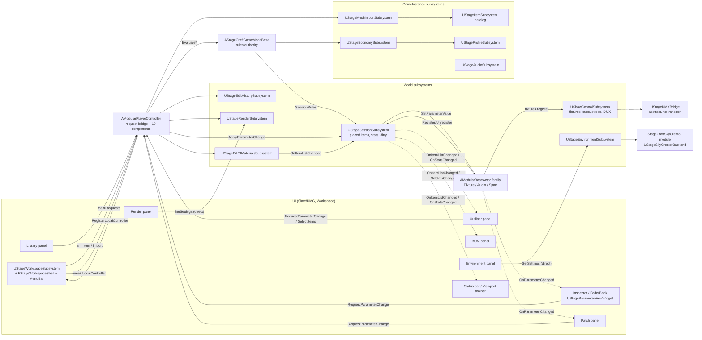

# StageCraft 3D: project audit and technical discovery

- **Date:** 2026-10-20. **Commit audited:** `960f5da` (work tree clean, branch `main`).
- **Scope:** the whole repository: `Source/` (250 files, about 42,400 lines), `Config/`, the `Content/` folder listing, `Scripts/`, `Docs/ADR/0001–0009`, `STATE.md` (#1–#35), `tasks/todo.md`, `Rules.md`.
- **Method:**
  - Static reading of source and config, done in six parallel areas: UI and workspace; scene and CAD; lighting and show; persistence and import; architecture; and documentation.
  - The most serious findings were then re-read and confirmed by hand.
  - The automation suite was run once: `UnrealEditor-Cmd … -ExecCmds="Automation RunTests StageCraft; Quit" -nullrhi`.
- **What was not done:**
  - No `.uasset` or `.umap` was opened. The Unreal editor bridge (MCP) was attached to another project's editor (Kmidden) for the whole audit.
  - Nothing was built, launched in PIE, or packaged.
  - No code was changed.
- **Companion document:** `Docs/CURRENT_SYSTEMS.md`, a one-page list of what exists and where it lives.
- **Follow-up (STATE.md #37, ADR 0010):** this report is a snapshot and is not rewritten. Since it was written:
  - **R3 fixed:** undo and redo now go through the GameMode, item by item.
  - **R4 fixed:** an inspector spin-box drag is one transaction.
  - **R5 fixed:** an exit prompt and autosave with recovery were added.
  - **R7 addressed:** the scene format is version 2 and migrates version 1.
  - **Sky Creator** was packaged and measured (ADR 0010 §7).
  - **R2, R6, R8 addressed in STATE.md #40 (ADR 0013 §3):**
    - **R2:** skipped items are kept and saved back; a partial load stays unsaved; damaged entries are backed up before a save; loads wait for imports.
    - **R6:** restored values are sanitized and counted; no package loads from saved state.
    - **R8:** a damaged import list is moved aside, an unreadable one is never overwritten, and every save is flushed before its rename.
    - **Found while fixing R6:** the DMX patch was never saved, because its fields were not SaveGame.
  - **Still open:** R1 and R9–R14. `Docs/CURRENT_SYSTEMS.md` is kept current.

### Evidence labels used in this document

| Label | Meaning |
|---|---|
| **VERIFIED** | An automation test that ran in this audit proves it. |
| **STATIC** | Read in source. The code path is complete, but nothing in this audit ran it. |
| **INFERRED** | Reasoned from code that was read. Not observed. |
| **DOC** | Stated in STATE.md or an ADR. Not re-checked. |

Paths are relative to `Source/ModularSceneBuilder/` unless they start with `Source/`, `Config/`, `Docs/`, `Content/`, `Scripts/` or a file at the repository root.

---

## 1. Executive summary

StageCraft 3D is a **single-module UE 5.8 C++ application**, plus a small plugin-adapter module. It runs as a game, not as an editor tool. The app is a docked Slate workspace around a game viewport: Library, Inspector, Fader Bank, Outliner, Patch, Bill of Materials, Render and Environment panels. You can do the following:
- place catalog items and parametric spans (truss, cable, railing);
- select and transform them with a custom gizmo, with grid, angle and object snapping;
- edit moving-head fixtures (dimmer, colour, CTC, zoom, pan/tilt, gobo, iris, shutters, strobe) that drive real spot lights;
- patch DMX addresses, with conflict detection;
- save and load scenes as JSON;
- import glTF/GLB/OBJ (and FBX in editor builds) at runtime;
- export a CSV bill of materials;
- render stills;
- switch an outdoor sky (Sky Creator) on and off with weather.

The architecture is **sound and mostly follows its own rules**:
- **Subsystems own state.** Writes from the UI go through the controller and the GameMode request bridge.
- **Event-driven.** Views are push-only, and panel rebuilds are deferred.
- **Tick-light.** Only three things tick: the camera pawn always, the gizmo only while attached, and show control only while busy. Nothing calls `GetAllActorsOfClass`.
- **Lifetime-safe.** Weak pointers for registries, GUID-addressed undo, async I/O on worker tasks.
- **Tests:** 46 of 46 automation tests pass, but they cover only pure logic (math, formats, stores).

The main gaps are not in the architecture. They are:
1. **Data safety.** Several confirmed paths lose or corrupt the user's work:
   - A partially loaded scene is marked clean, so the next Save permanently deletes the items that were skipped.
   - Closing the window never asks about unsaved changes, and there is no autosave.
   - Restored SaveGame values are not sanitized.
   - A corrupt import list is overwritten.
   - The profile is reset on a version mismatch.
2. **Edit integrity.**
   - Undo and redo of a transform bypass the item lock and the GameMode (confirmed).
   - Dragging an inspector spin box records an undo step on every change (confirmed in code), which can flush the whole 100-step history.
   - Fixture, patch, visibility, lock and label edits are not undoable.
3. **Show control is not reachable.**
   - The cue list and fade engine exist in C++ but have no UI, no C++ caller and no persistence.
   - DMX output and input are an empty abstract bridge, so nothing reaches hardware.
   - These are the biggest functional gaps for a lighting-visualisation product.
4. **Verification debt.**
   - Every STATE.md entry from #1 to #35 is "awaiting manual verification". No person has recorded a confirmed run.
   - Selection, the request bridge, the GameMode rules, the economy, the session and show control have no automated tests.
5. **Repository hygiene.**
   - An MCP auth token is committed in `Config/UserEngine.ini`.
   - STATE.md #35 still says "uncommitted" although it is in `4f310c2`.
   - Rules.md points to files and a project name from another project (`RunEditor.bat`, `DamenTools8`).
   - 19 disabled marketplace plugins are tracked.

**Most valuable next task:** a "scene data safety and edit integrity" pass (§11, step 1). It is small, contained and testable, and it removes every confirmed way to lose a user's stage.

---

## 2. Project structure and technology inventory

### 2.1 Engine, modules, targets
| Item | Value | Evidence |
|---|---|---|
| Engine | UE 5.8 (installed build) | `ModularSceneBuilder.uproject:3` |
| Core module | `ModularSceneBuilder` (Runtime) | `.uproject:6-10`, `Source/ModularSceneBuilder/ModularSceneBuilder.Build.cs` |
| Adapter module | `StageCraftSkyCreator` (Runtime). It implements the environment backend on top of Sky Creator. | `.uproject:11-15`, `Source/StageCraftSkyCreator/StageCraftSkyCreator.Build.cs` |
| Targets | Game and Editor. Both list both modules. BuildSettings V7, include order 5.8. | `Source/ModularSceneBuilder.Target.cs`, `Source/ModularSceneBuilderEditor.Target.cs` |
| Core public dependencies | Core, CoreUObject, Engine, InputCore, EnhancedInput, GameplayTags, UMG | `ModularSceneBuilder.Build.cs:11` |
| Core private dependencies | ProceduralMeshComponent, Slate, SlateCore, ApplicationCore, Json, DeveloperSettings, RenderCore, RHI, ImageCore, InterchangeCore/Engine/Pipelines. DesktopPlatform is used in Development builds; Shipping uses a COM file dialog instead (ole32/shell32). | `Build.cs:16-41` |
| Third-party code | None in the core. Sky Creator (marketplace, source included) is linked only by the adapter module. | `Source/StageCraftSkyCreator/StageCraftSkyCreator.Build.cs` |

### 2.2 Plugins
- **Enabled:**
  - Interchange.
  - ModelingToolsEditorMode (Editor only).
  - PythonScriptPlugin (Editor only).
  - **SkyCreatorPlugin.** Its descriptor's `EngineVersion` was set to 5.8.0 (ADR 0009 E3).
- **Disabled but tracked in `Plugins/`** (19, about 1,000 tracked files):
  - AdvancedFadeObjects, BuildManagerMath, CameraPresets, CraneControl, DamenFileManager.
  - DynamicDatatable, FileDropUMG, GizmoTool, NGGVideoRecorder, OverCrowd.
  - PlacementGizmo, PreciseTransform, RealTimeImport, SkyWeatherControls, SpaceCalculator.
  - SplineRouteTool, DlFileManager, UMGInSequence, UnrealNGGMCP.
  - Seven folder names do not match their plugin names; for example, `Plugins/RealTimeaac` holds RealTimeImport.

### 2.3 Source organisation (`Source/ModularSceneBuilder/{Public,Private}/…`)
| Folder | Contents |
|---|---|
| `Actors` | `AModularBaseActor`, `ALightingFixtureActor`, `AAudioEquipmentActor`, `AStageSpanActor`, `AModularTransformGizmo` |
| `Components` | `USelectionComponent`, `USpawnSystemComponent`, span geometry |
| `Data` | `UBaseItemData` and its subclasses, the parameter model |
| `Economy` | profile, products, commerce backend |
| `Subsystems` | session, show control, item catalog, profile, economy |
| `Game` | `AStageCraftGameModeBase`, session types |
| `Player` | `AModularPlayerController`, `AStageCameraPawn`, `UStageCraftGameViewportClient`, `UStageCraftGameEngine` |
| `Placement` | placement, snapping, guides and span tools, plus their math |
| `History` | undo/redo commands and history |
| `Interaction` | interfaces, group transform, transform rules |
| `Outliner` | outliner model |
| `Scene` | scene store and component |
| `Import` | runtime mesh import, thumbnails |
| `Report` | bill of materials |
| `Render` | still renders |
| `Show` | DMX bridge, photometry, show types |
| `Environment` | sky and weather |
| `Viewport` | projections, view modes, grid |
| `Workspace` | docking shell, layouts, menu bar |
| `UI` | all panels and widgets |
| `Audio` | UI feedback sounds |
| `Settings` | `UStageCraftUserSettings` |

Tests live in `Private/<Area>/Tests/`.

### 2.4 Content (folder listing only; `Content/StageCraft/`)
| Folder | Assets |
|---|---|
| **Blueprints** | `BP_StageCameraPawn`, `BP_StageCraftGameMode`, `BP_StageCraftPlayerController` |
| **Maps** | `L_StageTest`, the only map. It is both the game and the editor default map (`Config/DefaultEngine.ini:4,6`). |
| **Data / Items** | `DA_MovingHead_Test`, `DA_MovingHead_Wash_Test`, `DA_LineArray_Test`, `DA_Truss_Test`, `DA_Test_Crate`, `DA_Test_Light`, `DA_Span_TrussF34`, `DA_Span_CableRun`, `DA_Span_Railing` |
| **Shop** | `DA_Product_MovingHeadWash` |
| **UI** | `WBP_StageCraftHUD`, `WBP_StageInspectorPanel`, `WBP_StageParameterRow`, `WBP_StageParameterSection`, `WBP_StageFaderBank`, `DA_StageCraftTheme`, 8 × `DA_Panel_*`, `M_ThumbnailClay` |
| **Materials** | `M_StageBeamLightFunction` and 8 `T_Gobo_*`; `M_GizmoHandle`; `M_PlacementGhost` and `M_PlacementMarker`; `M_Span*`; `M_StageLineView` |
| **Audio** | `SFX_Error`, `SFX_Place`, `SFX_Select`, `SFX_Snap` |
| **Debug** | `BP_StageTestArmer` |

Every item and fixture asset is a test asset. There is no production equipment catalog yet. Most panels are C++-built widgets (`WidgetTree->ConstructWidget`); only 5 Widget Blueprints exist.

**Content scripts.** Content is created headlessly by `Scripts/Content/*.py` (one script per feature; each header lists its outputs) and `Scripts/*.ps1`. `Content/Python/stagecraft_setup_content.py` is **stale**: it creates `IA_*`, `IMC_StageEditor` and `BP_ModularPlayerController`, none of which exist.

### 2.5 Configuration highlights
- **Renderer** (`Config/DefaultEngine.ini:9-38`): Lumen GI and reflections, virtual shadow maps, mesh distance fields, ray tracing on, Substrate on, DX12 SM6. MegaLights off, because light functions are needed (ADR 0007).
- **Framework overrides** (`DefaultEngine.ini:5,91,93,95`):
  - GameMode `StageCraftGameModeBase`; GameViewportClient `StageCraftGameViewportClient`; GameEngine `StageCraftGameEngine`.
  - GameUserSettings `StageCraftUserSettings`.
  - No custom GameInstance.
- **Asset Manager** (`Config/DefaultGame.ini:13-16`), all three types set to AlwaysCook:

  | Asset type | Scans |
  |---|---|
  | `StageItem` | `/StageCraft/Items`, `/Data` |
  | `StageProduct` | `/Shop` |
  | `StagePanel` | `/UI/Panels` |

  The test assets therefore cook into Shipping (INFERRED).
- **Subsystem config** (`DefaultGame.ini:19-48`):
  - profile slot and a 5,000 starting balance;
  - commerce backend empty, meaning local;
  - thumbnail, beam and line-view materials;
  - environment backend `StageSkyCreatorBackend`;
  - audio cues;
  - cook directories (lines 52-68).
- **Dead config:** CommonUI settings at `DefaultGame.ini:2-8`, but CommonUI is not enabled.
- **Gameplay tags:** defined natively with `UE_DEFINE_GAMEPLAY_TAG`. `DefaultGameplayTags.ini` holds only two test entitlements.
- **Committed secret:** `Config/UserEngine.ini:2` holds `[UnrealNGGMCP] AuthToken=…` and is tracked by git (see §10, R1).

### 2.6 Tests and build
- **Tests:** 46 automation tests, all under the `StageCraft.*` prefix. Re-run in this audit: **46/46 Success, EXIT CODE 0** (13:59 local time, `-nullrhi`).
- **Build:** last recorded in STATE.md #35 (DOC) as 0 warnings for both the Editor Development and Game Shipping (`-DisableAdaptiveUnity`) builds. Not rebuilt here.
- **Tooling:** no CI configuration in the repository. Rules.md requires `RunEditor.bat` / `Scripts/Launch/RunEditor.ps1`, but **neither exists**.

---

## 3. Documentation: authority and inconsistencies

| Document | Authority | Health |
|---|---|---|
| `Rules.md` (imported by `CLAUDE.md`) | Rules: architecture, economy security, the Senior++ standard. | Contains stale text from another project: • `RunEditor.bat`, `Scripts/Launch/RunEditor.ps1`, `DamenTools8.uproject`, "STATE.md #200" and "UE 5.7" (`Rules.md:144-165`) • "UnrealClaude" tool names (`:5, :111`) • `damen-tools` tag examples The "Where state lives" table lists 5 of 12 subsystems and 2 of 10 controller components, and ignores `UStageCraftUserSettings`. |
| `STATE.md` | Project status and history. | #35 says `**Commit:** uncommitted (working tree).` (`STATE.md:2796`) but is in `4f310c2`. `960f5da` (a `.claude/.ngg-assets.json` change) has no entry. No entry records a confirmed manual run by Gevor. |
| `tasks/todo.md` | Backlog. | Stale open boxes for items already done: lines 7, 32, 47, 49, 92, 198. |
| `Docs/ADR/0001–0009` | Design records. They are in the repo because the Obsidian vault (`S:\`) is unreachable. | Checked against code; all concrete constants and classes match. One exception: ADR 0001 §3 (`0001:132`) still says layouts live in `Saved/StageCraft/Layouts` with built-ins "Stage Design / Show Control / Dual Monitor". The code uses `Saved/StageCraft/Workspace/Layouts` with "Default" and "Viewport Only" (`Private/Workspace/StageWorkspaceSubsystem.cpp:32-33,70`). §9 of the same ADR is correct. |
| `AGENTS.md`, `State.md`, `README` | — | Do not exist. |
| Obsidian vault `S:\OBSIDIAN VAULTS\…` | Rules.md session, lesson and bug memory. | Unreachable (no `S:` drive). Lessons and postmortems have no home in the repo. |

---

## 4. Feature inventory and status

Status values are those required by the audit brief. "Tests" names the automation tests that cover the feature; all of them passed in this audit.

### 4.1 Application and UI
| Feature | Status | Evidence |
|---|---|---|
| Startup: GameMode → controller → workspace install | IMPLEMENTED — STATIC INSPECTION ONLY | `Private/Game/StageCraftGameModeBase.cpp:17-37`; `Private/Player/ModularPlayerController.cpp:90-174`; `Private/Workspace/StageWorkspaceSubsystem.cpp:102-276` |
| Docked workspace (tabs, floating windows, detachable viewport) | IMPLEMENTED — STATIC INSPECTION ONLY. **Standalone and packaged only.** In PIE the subsystem is not created (`StageWorkspaceSubsystem.cpp:60-64`) and `WBP_StageCraftHUD` is used instead. | `Private/Workspace/StageWorkspaceShell.cpp:62-121, 487-516, 583-609`; `Private/Player/StageCraftGameEngine.cpp:16-127` |
| Layout and session persistence (`Session.json`, named layouts) | Store: IMPLEMENTED AND VERIFIED. Shell integration: STATIC. | `Private/Workspace/StageLayoutStore.cpp`; tests `StageCraft.Workspace.LayoutStore.*` (5) |
| Menu bar (File, Edit, Render, Window, Layout, Audio) | IMPLEMENTED — STATIC INSPECTION ONLY | `Private/Workspace/SStageWorkspaceMenuBar.cpp:43-53` |
| Confirmation dialogs | PARTIALLY IMPLEMENTED. Confirmations are nested sub-menus; there are no modal dialogs. | `SStageWorkspaceMenuBar.cpp:242-248, 263-267, 433-444` |
| Status bar, viewport toolbar (5 sections) | IMPLEMENTED — STATIC INSPECTION ONLY. Toolbar layout was screenshot-checked in #35 (DOC). | `Private/UI/StageStatusBarWidget.cpp`, `Private/UI/StageViewportToolbar.cpp`; tests `StageCraft.UI.StatusHint`, `.SpanHint` |
| Inspector (sections, rows, read-back) | IMPLEMENTED — STATIC INSPECTION ONLY | `Private/UI/StageParameterViewWidget.cpp:73-246`, `Private/UI/StageParameterRowWidget.cpp` |
| Inspector numeric drag | PRESENT BUT BROKEN (static). One undo step is recorded per spin change; see §10, R4. | `StageParameterRowWidget.cpp:123,145,448-467`; `ModularPlayerController.cpp:1039-1047`; `Private/History/StageCommandHistory.cpp:10-25` |
| Fader bank, pan/tilt encoder | IMPLEMENTED — STATIC INSPECTION ONLY | `Private/UI/StageFaderWidget.cpp`, `Private/UI/StageEncoderWidget.cpp` |
| Colour picker (HSV) | NOT FOUND. Colour is three percentage spin boxes plus a swatch; `bSupportsColorEditing` is set but nothing reads it. | `StageParameterRowWidget.cpp:302-312, 409-416`; `Public/Interaction/InteractableInterface.h:29-34` |
| Selection: click, Ctrl-toggle, Select All, outliner and patch selection | IMPLEMENTED — STATIC INSPECTION ONLY. **No tests.** | `Private/Components/SelectionComponent.cpp:124-164`; `ModularPlayerController.cpp:584-605, 1140, 1162-1186` |
| Hover highlight | NOT FOUND. `OnHoverBegin` and `OnHoverEnd` are declared but never called. | `Public/Interaction/InteractableInterface.h` |
| Marquee / box select | NOT FOUND | — |
| Input and shortcuts | IMPLEMENTED — STATIC INSPECTION ONLY. Mappings are built in code, so there are no IMC or IA assets (`ModularPlayerController.cpp:276-399`). No shortcuts for Save, Select All, hide/lock, view modes or projections. | — |
| Preferences panel, key-binding editor (ADR 0001 phases 3–4) | NOT FOUND | `tasks/todo.md:151-152` |
| Shop UI (wallet, buy buttons, lock badges) | NOT FOUND. The back end exists (§4.6). | `STATE.md:1182-1183` |

### 4.2 Scene and CAD
| Feature | Status | Evidence |
|---|---|---|
| Placement: ghost, landing, stamping, rules-validated deferred spawn | IMPLEMENTED — STATIC INSPECTION ONLY. Math VERIFIED. | `Private/Placement/StagePlacementToolComponent.cpp:92-189`; `Private/Components/SpawnSystemComponent.cpp:56-92`; tests `StageCraft.Placement.Math`, `.ToolModes` |
| Delete and multi-delete (one undo step) | IMPLEMENTED — STATIC INSPECTION ONLY | `Private/History/StageEditHistoryComponent.cpp:199-252` |
| Clear Stage (one undo step) | IMPLEMENTED — STATIC INSPECTION ONLY | `StageEditHistoryComponent.cpp:207-222` |
| Duplicate / copy-paste | NOT FOUND | — |
| Gizmo move, rotate, scale (world space) | IMPLEMENTED — STATIC INSPECTION ONLY. Scale rules VERIFIED. | `Private/Actors/ModularTransformGizmo.cpp:269-436`; test `StageCraft.Gizmo.ScaleRules` |
| Local-space gizmo, scale snapping | NOT FOUND | `ModularTransformGizmo.cpp:223` forces a zero rotation |
| Group (multi-selection) transform | IMPLEMENTED. Leader math VERIFIED; drag STATIC. | `Public/Interaction/StageGroupTransform.h:20`; test `StageCraft.Selection.GroupTransform` |
| Numeric transform (cm, degrees, ×) | IMPLEMENTED — STATIC INSPECTION ONLY. Not grid-snapped. | `Private/Actors/ModularBaseActor.cpp:356-362, 454-470` |
| Grid and angle snap (presets, persisted per user) | IMPLEMENTED AND VERIFIED (math) | `Public/Viewport/StageViewMath.h:26-27,111-120`; tests `StageCraft.Viewport.Snap`, `.Grid` |
| Object-to-object snap and alignment guides | IMPLEMENTED. Math VERIFIED; integration STATIC. | `Private/Placement/StageSnappingComponent.cpp:142-263`; test `StageCraft.Snap.Math` |
| Perspective plus Top/Front/Back/Left/Right ortho, ortho pan and zoom-at-cursor | IMPLEMENTED. Math VERIFIED. | `Private/Viewport/StageViewportComponent.cpp:123-355`; tests `StageCraft.Viewport.Projection`, `.OrthoMath` |
| View modes: Lit, Unlit, CAD Lines (post-process), Lighting Only, Detail Lighting, Reflections | IMPLEMENTED — STATIC INSPECTION ONLY. The diagnostic modes are refused in Shipping. There is no true engine wireframe; it is compiled out of Shipping (ADR 0008 F2). | `Private/Player/StageCraftGameViewportClient.cpp:11-69`; `Private/Viewport/StageLineViewCameraModifier.cpp:16-24` |
| Reference grid (line batch, event-driven redraw) | IMPLEMENTED AND VERIFIED (line math) | `Private/Viewport/StageGridActor.cpp`; test `StageCraft.Viewport.Grid` |
| Outliner: discipline groups, visibility, lock | IMPLEMENTED. Model VERIFIED. Groups are **derived** from the catalog category; there are no user groups or parenting (ADR 0005). | `Public/Outliner/StageOutlinerModel.h:47-73`; `Private/UI/StageOutlinerPanel.cpp`; test `StageCraft.Outliner.Model` |
| Parametric spans (multi-point path, closed loop, parabolic sag) | IMPLEMENTED AND VERIFIED (math) | `Private/Placement/StageSpanMath.cpp`; tests `StageCraft.Span.Layout`, `.Placement`, `.Instances`, `.Path`, `.Sag` |
| Editing span path points after placement | NOT FOUND. Only length (single leg) and sag can be edited. | `Private/Actors/StageSpanActor.cpp:65, 201-203` |
| Undo/redo (100 steps, GUID-addressed, batch rollback) | IMPLEMENTED AND VERIFIED (stack and commands) | `Private/History/*`; tests `StageCraft.History.Stack`, `.ItemCommands`, `.Batch`, `.Parameter` |
| Undo coverage | PARTIALLY IMPLEMENTED. Place, delete, clear, gizmo, numeric transform and span shape are undoable. Fixture attributes, patch, label, visibility, lock, type swap and environment are not. | `ModularPlayerController.cpp:1018-1052`; `Private/Data/StageParameterTypes.cpp:168-171` |
| Undo respects locks and rules | PRESENT BUT BROKEN. See §10, R3. | `StageEditHistoryComponent.cpp:80-94` |
| Orbit, pan and frame-selected (F) camera | NOT FOUND. The fly camera only. | `tasks/todo.md:68` |

### 4.3 Lighting and rendering
| Feature | Status | Evidence |
|---|---|---|
| Fixture actor (base → pan pivot → yoke → tilt pivot → head plus `USpotLightComponent`, shadows on) | IMPLEMENTED — STATIC INSPECTION ONLY | `Private/Actors/LightingFixtureActor.cpp:119-142` |
| Fixture data model (capabilities, ranges, defaults, DMX layout) | IMPLEMENTED AND VERIFIED | `Public/Data/LightingFixtureData.h:78-250`; test `StageCraft.Lighting.FixtureData` |
| Dimmer, RGB(W), CTC, zoom drive the real light | IMPLEMENTED — STATIC INSPECTION ONLY. The UI edit reaches `SetIntensity`, `SetLightColor`, `SetTemperature` and the cone angles. | `LightingFixtureActor.cpp:374-418` |
| Pan/tilt | IMPLEMENTED — STATIC INSPECTION ONLY. Moves are instant; there is no slew or speed model. | `LightingFixtureActor.cpp:383-387` |
| Gobo, gobo rotation (static angle), iris, framing blades | IMPLEMENTED — STATIC INSPECTION ONLY. Uses one light-function MID per fixture, created lazily. The material is generated by `Scripts/Content/create_lighting_content.py`. | `LightingFixtureActor.cpp:420-463` |
| Shutter / strobe (shared strobe clock) | IMPLEMENTED — STATIC INSPECTION ONLY. Flashing has never been seen by a person (DOC #30). | `LightingFixtureActor.cpp:478-497`; `Private/Subsystems/ShowControlSubsystem.cpp` |
| Photometrics (lux at throw, field size) | IMPLEMENTED AND VERIFIED (math). Display only. | `Public/Show/StagePhotometry.h`; test `StageCraft.Lighting.Photometry` |
| `FixtureKind` (wash, spot, laser, strobe) | PARTIALLY IMPLEMENTED. Stored but never read, so every kind renders as a spot. | `Public/Data/LightingFixtureData.h:10-18` |
| Beam visualisation | PARTIALLY IMPLEMENTED. Beams rely on the level's volumetric fog. There is no cone mesh, and `VolumetricScatteringIntensity` is never set. | DOC #10; `tasks/todo.md:50` |
| IES profiles, user-editable attenuation, shadow toggle | NOT FOUND | — |
| Still render (resolution presets, AA, Clean/Standard/Cinematic, follows projection and framing, async PNG) | IMPLEMENTED. Rules and framing VERIFIED; capture STATIC. | `Private/Render/StageRenderSubsystem.cpp`; tests `StageCraft.Render.Rules`, `.Framing` |
| Render reproduces the viewport view mode | NOT FOUND (INFERRED). The capture sets only its own AA and motion-blur flags. | `StageRenderSubsystem.cpp:279, 305-309` |
| Render cancel | PARTIALLY IMPLEMENTED. `CancelJob` is private and has no UI. | `Public/Render/StageRenderSubsystem.h:128` |
| Path tracing, scalability or exposure controls | NOT FOUND | — |
| Outdoor environment (sky on/off, time, sun, clouds, rain, snow, fog) | IMPLEMENTED AND VERIFIED (sanitize, presets, mapping, world spawn and teardown). Screenshot-checked in #35 (DOC). | `Private/Environment/*`, `Source/StageCraftSkyCreator/*`; tests `StageCraft.Environment.Sanitize`, `.Presets`, `.SkyCreatorMapping`, `.SkyCreatorWorld` |

### 4.4 Timeline and show control
| Feature | Status | Evidence |
|---|---|---|
| Cue data (number, label, fade time, per-fixture attribute snapshot) | IMPLEMENTED — STATIC INSPECTION ONLY | `Public/Show/ShowControlTypes.h:137-155` |
| Store cue, Go, GoToCue, linear crossfade, take-over from live values | PARTIALLY IMPLEMENTED. The engine exists, but **nothing in C++ calls it** (`StoreCue`, `GoToCue`, `Go`, `SetCues` are referenced only inside the subsystem). Whether a Blueprint calls them is UNKNOWN. | `Private/Subsystems/ShowControlSubsystem.cpp:293-459` |
| Cue list UI and playback controls | NOT FOUND | `tasks/todo.md:48` |
| Cue persistence | NOT FOUND. `Cues` is `Transient`, and the scene document holds only items. | `Public/Subsystems/ShowControlSubsystem.h:200-201`; `Public/Scene/StageSceneTypes.h:73-85` |
| Per-attribute timing, delays, follows, curves, effects, chases, palettes, tracking | NOT FOUND | — |
| Sequencer / timeline | NOT FOUND. No MovieScene or LevelSequence use. | `ModularSceneBuilder.Build.cs` |

### 4.5 DMX and fixture data
| Feature | Status | Evidence |
|---|---|---|
| Patch data (universe 1–63999, address 1–512, 0 = unpatched) | IMPLEMENTED — STATIC INSPECTION ONLY | `Public/Show/ShowControlTypes.h:101-117`; `LightingFixtureActor.cpp:573-594` |
| Auto-ID and auto-patch on register | IMPLEMENTED — STATIC INSPECTION ONLY | `ShowControlSubsystem.cpp:119-140, 198-247` |
| Conflict detection (overlap per universe, shown in the Patch panel) | IMPLEMENTED — STATIC INSPECTION ONLY. **No test.** | `ShowControlSubsystem.cpp:249-279`; `Private/UI/StagePatchPanel.cpp:354-359, 509-523` |
| DMX encode/decode (8/16-bit, CMY) and a simulated live-value column | IMPLEMENTED. Data-level round trip VERIFIED; the actor path is STATIC. | `LightingFixtureActor.cpp:602-677`; `StagePatchPanel.cpp:614-625`; test `StageCraft.Lighting.FixtureData` |
| External DMX output (Art-Net / sACN / USB) | NOT FOUND. `UStageDMXBridge` is abstract, `SendUniverse` is empty, there is no subclass, and `SetDMXBridge` has no caller. | `Private/Show/StageDMXBridge.cpp:21-24`; `ModularSceneBuilder.Build.cs:43-44` |
| External DMX input driving fixtures | PARTIALLY IMPLEMENTED. Wired (`ReceiveDMXUniverse` → `ReadDMX`) but unreachable (`SetControlSource` has no caller). | `ShowControlSubsystem.cpp:481-515` |
| Multiple DMX modes per fixture | NOT FOUND. One mode per data asset. | `tasks/todo.md:107` |

### 4.6 Assets, BOM, persistence, economy, audio
| Feature | Status | Evidence |
|---|---|---|
| Catalog (Asset Manager `StageItem`, UI bundle streaming, runtime items) | IMPLEMENTED — STATIC INSPECTION ONLY | `Private/Subsystems/StageItemSubsystem.cpp:16-145` |
| Library panel (search, categories, Import button, thumbnails) | IMPLEMENTED. Search VERIFIED. | `Private/UI/StageItemLibraryPanel.cpp`; test `StageCraft.UI.LibrarySearch` |
| Runtime import (Interchange, glb/gltf/obj, plus fbx in editor builds; 512 MB cap; Datasmith refused) | IMPLEMENTED. Rules VERIFIED; the import itself is STATIC. Packaged import is unverified (DOC #28). | `Private/Import/StageMeshImportSubsystem.cpp:139-351`; tests `StageCraft.Import.Formats`, `.Identity`, `.DialogFilter`, `.List` |
| Remove or forget an import; release its memory | NOT FOUND | `STATE.md:2172` |
| Scene save/load (JSON, atomic write, worker I/O, validated parse) | IMPLEMENTED. Store VERIFIED; `ApplyDocument` STATIC. | `Private/Scene/StageSceneStore.cpp`, `Private/Scene/StageSceneComponent.cpp`; tests `StageCraft.Scene.Format`, `.Files` |
| Scene format migration | NOT FOUND. Only version 1 is accepted; any other version is refused. | `Private/Scene/StageSceneStore.cpp:282-285` |
| Autosave, recovery, prompt on quit | NOT FOUND | `Private/Workspace/StageWorkspaceShell.cpp:572-581` |
| Bill of materials (count, kg, W, discipline groups, event-driven refresh) | IMPLEMENTED AND VERIFIED (build, format, CSV) | `Public/Report/StageBillOfMaterials.h:79`; `Private/Report/StageBillOfMaterialsSubsystem.cpp`; tests `StageCraft.Report.Build`, `.Csv`, `.Format` |
| BOM export | PARTIALLY IMPLEMENTED. CSV only, with formula-injection escaping. No PDF or XLSX, cable schedule, drawings, amps/phase or rigging loads. | `StageBillOfMaterialsSubsystem.cpp:128-191` |
| Profile, wallet, entitlements, integrity hash, purchase pipeline | IMPLEMENTED — STATIC INSPECTION ONLY. **No tests.** Scripted PIE run only (DOC #18). | `Private/Subsystems/StageProfileSubsystem.cpp`, `Private/Subsystems/StageEconomySubsystem.cpp:239-385` |
| Server-side commerce | NOT FOUND. `UStageLocalCommerceBackend` approves everything. | `Private/Economy/StageCommerceBackend.cpp` |
| UI audio feedback, volume and mute | IMPLEMENTED. Math and settings VERIFIED. | `Private/Audio/StageAudioSubsystem.cpp`; tests `StageCraft.Audio.Math`, `.UserSettings` |
| Loudspeaker parameters (gain, delay, polarity, splay) | IMPLEMENTED as design data only; nothing is rendered acoustically. | `Public/Actors/AudioEquipmentActor.h:10-60` |

---

## 5. Execution-path traces

All traces below are **STATIC**: read in code, not run. Arrows follow the call order.

### 5.1 Select an object in the viewport
1. **Trace:**
   1. LMB fires Enhanced Input `PlaceAction` (Started), which calls `AModularPlayerController::HandlePrimaryStarted` (`ModularPlayerController.cpp:254, 505-512`).
   2. `HandlePrimaryPressedAt` (`:529-563`) checks, in order: navigating? place mode? gizmo handle hit (`TryBeginGizmoDragAt`)? Otherwise it calls `SelectOrDeselectAt` (`:584-605`).
   3. That runs `GetHitResultAtScreenPosition` on the `ECC_GameTraceChannel1` "StageItem" channel (`:455-458`; channel defined at `Config/DefaultEngine.ini:113`).
   4. It then calls `USelectionComponent::SelectActor` or `ToggleActorSelection` (Ctrl) or `ClearSelection`, all of which go through `ApplySelection` (`Private/Components/SelectionComponent.cpp:124-164`).
2. **Authoritative data:** `USelectionComponent::SelectedActors`, ordered; the last entry is the primary.
3. **Scene update:** the actor's `OnSelect` sets the overlay material, and `AModularTransformGizmo::AttachToTarget` attaches the gizmo (`ModularPlayerController.cpp:401-407`).
4. **Notified:**
   - `OnSelectionChanged`: Inspector and Fader Bank (`UStageParameterViewWidget`).
   - `OnSelectionSetChanged`: Outliner and Patch panels.
5. **Persistence:** none. Selection is transient, which is correct.
6. **Fragile points:**
   - Selection needs every item mesh to block channel 1. This is set in C++ (`ModularBaseActor.cpp:36`, `LightingFixtureActor.cpp:29`), but a Blueprint item with extra meshes could silently be unclickable.
   - There are no tests for the click path.

### 5.2 Select an object → Inspector
1. `OnSelectionChanged` calls `UStageParameterViewWidget::HandleSelectionChanged`, which calls `Inspect` (`StageParameterViewWidget.cpp:73-101`).
2. `Inspect` unbinds the previous actor and binds `OnParameterChanged`.
3. `Rebuild` runs `GetParameterSections`, then `Controller->DecorateParameterSections` (lock display), then `BuildView` (`:130-148`).
4. Gaps:
   - Every selection change re-creates every section and row widget.
   - If the Inspector tab is closed, nothing opens it.
   - Only the primary item of a multi-selection is shown.
   - The row and section classes are Blueprint-set; if they are missing, only a warning is logged.

### 5.3 Change location, rotation, scale or colour
**Inspector path**
1. Row spin box `OnValueChanged` → `CommitValue` → `UStageParameterViewWidget::CommitParameter` (`StageParameterViewWidget.cpp:180-207`).
2. `AModularPlayerController::RequestParameterChange` (`ModularPlayerController.cpp:981-1060`) does the following in order:
   1. `GameMode->EvaluateParameterChange`: lock, scaling support, limits and entitlements (`StageCraftGameModeBase.cpp:80-129`).
   2. Group verdict.
   3. `UStageSessionSubsystem::ApplyParameterChange` (`StageSessionSubsystem.cpp:226-239`).
   4. `WriteParameter` (`ModularBaseActor.cpp:454-470` for transforms; `LightingFixtureActor.cpp:829-877` for colour).
   5. History record (transforms and span shape only).
3. **Read-back:** `HandleRootTransformUpdated` (`ModularBaseActor.cpp:484-490`) or `NotifyAttributeChanged` fires `OnParameterChanged`, the views refresh, and the committed value is re-read.
4. **Persistence:** the transform is stored in the scene JSON; colour is stored in the fixture's SaveGame `Attributes`.
5. **Gaps:**
   - Colour exists only on lights and is not undoable.
   - Colour and other non-transform edits apply only to the primary selection.
   - A spin-box drag records an undo step per change (R4).

**Gizmo path**
1. Press: `EvaluateSelectionTransform` (checks only that the item may move at all; `ModularPlayerController.cpp:606-631, 1077-1101`).
2. Each frame while held: `UpdateDrag` → `SetActorLocation` / `SetActorRotation` / `SetActorScale3D` (`ModularTransformGizmo.cpp:347-407`). The actor is written directly, not through `ApplyParameterChange`.
3. Each root `TransformUpdated` fires 3 `OnParameterChanged` broadcasts, and the session dirty serial increments 3 times per frame.
4. Release: `OnDragFinished` → `RecordTransformChanges` (`ModularPlayerController.cpp:678-690`).

### 5.4 Change a light or fixture property
1. A fader, encoder or inspector control commits through the same path as §5.3, ending in `ALightingFixtureActor::WriteParameter` (`LightingFixtureActor.cpp:829-877`).
2. `SetAttribute(s)` (`:299-358`) calls `StoreAttribute`, which clamps, rejects NaN and rounds stepped values (`:237-264`).
3. `ApplyAttributesToComponents` (`:374-418`) updates intensity, colour, temperature, cones and pivots. `ApplyBeamShaping` (`:420-463`) updates gobo, iris and blades on the MID.
4. `NotifyAttributeChanged` (`:266-290`) refreshes the Inspector, the faders and the Patch panel's live-value column.
5. **Persistence:** yes, through SaveGame `Attributes` and `Patch`. Not undoable.
6. **Conflict:** if a cue fade were running, `TickFades` would overwrite the edit on the next frame (`ShowControlSubsystem.cpp:441-458`). This is INFERRED and currently unreachable, because nothing starts a fade.

### 5.5 Create and delete scene objects
- **Create:**
  1. LMB in Place mode → `UStagePlacementToolComponent::TryPlace` (`StagePlacementToolComponent.cpp:155-189`).
  2. `USpawnSystemComponent::SpawnValidated`: `SpawnActorDeferred` → `PlacementValidator`, which is bound to `ValidatePlacement` → GameMode, session limits and entitlements → `FinishSpawning` or `Destroy` (`SpawnSystemComponent.cpp:56-92`).
  3. `AModularBaseActor::BeginPlay` creates the GUID and calls `UStageSessionSubsystem::RegisterItem` (`ModularBaseActor.cpp:100-113`; `StageSessionSubsystem.cpp:47-69`). That recomputes stats, broadcasts `OnItemListChanged` (Outliner and BOM) and sets the dirty flag.
  4. `OnItemPlaced` records history.
- **Delete:**
  1. Delete key → `RequestDeleteSelection` (`ModularPlayerController.cpp:1127-1138`).
  2. `UStageEditHistoryComponent::DeleteItems` → `DeleteAsOneStep`, which snapshots the items, then deselects and destroys them (`StageEditHistoryComponent.cpp:199-252`).
  3. `EndPlay` → `UnregisterItem`.
  4. Deleting does not consult the GameMode, and locked items can be deleted. Both are by design (`ModularBaseActor.h:79-80`).

### 5.6 Save and reopen a project
- **Save:**
  1. File › Save → `RequestSaveScene` (`ModularPlayerController.cpp:1272`) → `UStageSceneComponent::SaveScene` (`StageSceneComponent.cpp:92`).
  2. `CaptureSnapshot` runs per item on the game thread: transform, GUID and a base64 SaveGame blob (`ModularBaseActor.cpp:260-275`).
  3. A worker task runs `FStageSceneStore::Save`, which writes atomically through a temp file and a move (`StageSceneComponent.cpp:114-124`).
  4. On the game thread, `MarkClean` runs, but only if the edit serial did not change in the meantime.
- **Open:**
  1. `RequestLoadScene` → `LoadScene` (catalog must be loaded) → worker `Load` and `Parse`. Parse validates GUIDs, paths, finite values, ranges, the 10,000-item cap and the 64 KB state cap (`StageSceneStore.cpp:73-133, 262-326`).
  2. `ApplyDocument` (`StageSceneComponent.cpp:244-297`):
     1. Destroys the current stage.
     2. Restores each item through the placement evaluator and `RestoreItem`.
     3. Clears history and calls `MarkClean`.
- **Persisted:** transforms, label, hidden, locked, fixture ID, patch and attributes, span path and sag, loudspeaker settings.
- **Not persisted:** cues, environment, camera, imported meshes (only their path is stored).
- **Gaps:** see R2, R5, R6, R7.

### 5.7 Import an asset
1. Entry points: Library IMPORT button, drag-drop (`SStageFileDropTarget`), or File menu. All go to `RequestImportModelFiles` (`ModularPlayerController.cpp:1200-1252`).
2. `UStageMeshImportSubsystem::RequestImport` → `ValidateRequest` (`StageMeshImportSubsystem.cpp:139-186`) → serial queue → Interchange `ImportAssetAsync` with a static-mesh-only, combined, Nanite-off pipeline (`:219-277`).
3. `FinishActiveImport` → `CollectActiveImport`:
   1. Creates a transient `UStageImportedItemData` and a thumbnail.
   2. `UStageItemSubsystem::AddRuntimeItem`, which broadcasts `OnCatalogChanged`, so the Library rebuilds.
   3. Appends the file to `Imports.json`.
4. On every launch, all remembered files are re-imported.
5. **Gaps:**
   - No remove.
   - Memory is held for the whole run.
   - Item identity is a hash of the absolute source path, so moving the source file orphans the item in every scene.
   - Imports carry 0 kg and 0 W.
   - Packaged builds have no FBX.
   - R8.

### 5.8 Update equipment information and the BOM
1. Weight and power are `EditDefaultsOnly` catalog data (`Public/Data/StageItemTypes.h:51-65`). **There is no runtime editing of equipment data.**
2. At runtime, the BOM changes only through place/delete, a Type swap, span length, or a listing parameter (label, visible, locked).
3. Path: `UStageSessionSubsystem::OnItemListChanged` → `UStageBillOfMaterialsSubsystem` marks itself stale (`StageBillOfMaterialsSubsystem.cpp:81-85`) → `OnReportChanged` → the panel rebuilds on the next tick (`StageBillOfMaterialsPanel.cpp:344-352`) → `GetReport` rebuilds lazily (`:87-121`).
4. This is fully event-driven, with no polling.

### 5.9 Start or change lighting playback
**Not reachable.**
- `UShowControlSubsystem::StoreCue`, `GoToCue` and `Go` exist (`ShowControlSubsystem.cpp:293-404`), and the subsystem ticks only while a fade is active (`:51-64`).
- No C++ code, console command, input binding or panel calls them. A Blueprint caller is UNKNOWN until `BP_StageCraftPlayerController` and `WBP_StageCraftHUD` are inspected in the editor.

---

## 6. Architecture and dependency map

### 6.1 Existing systems (as built)

Solid arrows are calls. Dotted arrows are delegate notifications. The dashed `SHOW → DMXB` edge is never live, because no bridge is ever set.

### 6.2 Data ownership
| State | Owner (source of truth) | Lifetime | Persisted where |
|---|---|---|---|
| Placed items and their parameters | The actors, registered in `UStageSessionSubsystem::Items` (weak) | World | Scene JSON |
| Session totals and dirty flag | `UStageSessionSubsystem` | World | — |
| Selection | `USelectionComponent` (controller) | Controller | — |
| Undo stack | `UStageEditHistorySubsystem` | World | — (cleared on load) |
| Fixture IDs, patch, cues, strobe clock | `UShowControlSubsystem` (cues), the fixtures (ID, patch) | World | Fixture state: scene. Cues: **nowhere**. |
| Environment | `UStageEnvironmentSubsystem` | World | **nowhere** |
| Catalog | `UStageItemSubsystem` | Game instance | Assets, plus `Imports.json` for imported items |
| Wallet and entitlements | `UStageProfileSubsystem`, written only by `UStageEconomySubsystem` (friend) | Game instance | SaveGame slot `StageCraftProfile` |
| Snap, render and audio preferences | `UStageCraftUserSettings` | Process | `GameUserSettings.ini` |
| Workspace layout | `UStageWorkspaceSubsystem` | Game instance | `Saved/StageCraft/Workspace/Session.json` and named layouts |
| Projection and view mode | `UStageViewportComponent` | Controller | — (not persisted) |

### 6.3 Coupling and duplication
- **One runtime cycle: Workspace ↔ PlayerController.**
  - The controller registers itself with the workspace (`ModularPlayerController.cpp:161`).
  - The workspace includes the concrete controller header and calls back into it (`StageWorkspaceSubsystem.cpp:14, 199, 368`).
  - It is mitigated by a weak pointer, but a game-instance subsystem now depends on a concrete controller class.
- **No header include cycles.** Economy → Profile is a one-way friend relationship.
- **Two UI hosts:** the docked workspace (Standalone and packaged) and `WBP_StageCraftHUD` (PIE). Features can drift between them.
- **Three transform write paths:** gizmo direct, `WriteParameter`, and undo `SetItemTransform`. Rule enforcement exists only on the second, which is the root cause of R3.
- **Direct panel → subsystem writes outside the request bridge:**
  - Environment (`StageEnvironmentPanel.cpp:436,454`).
  - Render settings (`StageRenderPanel.cpp:381`).
  - Audio preferences (menu bar `:464,482`).
  - Render and audio are per-user preferences and acceptable. Environment is scene state, and Rules.md's "one write path" should be applied to it, or the exception recorded.
- **God class:** `AModularPlayerController` is 1,518 + 525 lines, 42 UFUNCTIONs and about 9 responsibilities:
  - **Its intended roles:** the request bridge, rejection reporting and lock decoration.
  - **Everything else, which could be split out:**
    - code-built input mapping;
    - cursor tracing;
    - click-to-select and gizmo-drag orchestration;
    - camera input;
    - preview refresh;
    - dev input simulation.
  - Splitting them into a viewport-interaction component would cut its size roughly in half.
- **Systems to extend, not replace:**
  - session and request bridge;
  - history (GUID commands);
  - scene store;
  - layout store;
  - fixture apply path;
  - show-control subsystem (the engine is sound and needs a UI and persistence);
  - BOM builder;
  - environment backend boundary (the same pattern should be used for DMX).

---

## 7. UI, lighting, rendering and timeline analysis (summary)

- **UI.** Consistent and event-driven. Every panel binds with `AddUniqueDynamic`, unbinds in `NativeDestruct`, and defers rebuilds to the next tick with a kept timer handle.
  - **Known visual defect:** the invisible 1 px header lines in the BOM, Library, Outliner, Patch, Render and StatusBar panels. They call `UImage::SetDesiredSizeOverride` before Slate exists (ADR 0009 E7); the fix is `StageCraftWidgetStyle::MakeLine`.
  - No modal dialog framework, no colour picker, no hover highlight, no box select, few shortcuts.
- **Lighting.**
  - **What works:** the attribute → component path is complete and correct, the MID is created once per fixture, and the strobe clock is shared rather than ticked per actor.
  - **What is missing for professional visualisation:**
    - beam rendering that does not depend on level fog (and the Sky Creator backend *hides* the level's height fog when the sky turns on, so beams may vanish outdoors; INFERRED, not tested);
    - IES profiles;
    - pan/tilt speed;
    - `FixtureKind` behaviour (laser, strobe, wash);
    - multiple DMX modes;
    - undo for fixture edits;
    - group edits of attributes.
- **Rendering.** The render subsystem is a clean state machine with async encode. Gaps:
  - it does not mirror viewport view modes;
  - no path tracer;
  - no scalability or exposure controls;
  - cancel is not exposed.
- **Timeline.** A cue-only crossfade engine exists, but it is unreachable and unsaved. A real timeline is absent:
  - per-attribute times, follows, effects or tracking;
  - Sequencer.
  This is the largest functional gap relative to "lighting visualisation".

## 8. BOM and reporting analysis

- **Correct and deterministic:** the pure builder sanitises negatives and NaN and merges by catalog path. The export is safe: RFC 4180 CSV, formula-injection escape, atomic worker write.
- **Missing for production paperwork:**
  - amps per phase and circuit;
  - rigging point loads (span weight per metre exists, but there is no load model);
  - cable schedule;
  - patch-sheet export (data exists in the Patch panel);
  - PDF/XLSX;
  - technical drawings (ortho views and a CAD-line mode exist and could be the basis).
- **Imported models** contribute 0 kg and 0 W, with no way to enter specs.
- **Catalog data** has weight, power and manufacturer only. There are no dimensions, connectors, SKU or current fields.

---

## 9. Performance and reliability findings

### 9.1 Performance
Measured evidence is limited. STATE.md frame-cost notes are single samples (DOC). Everything below is INFERRED from code; nothing was profiled in this audit.

| # | Finding | Evidence | Expected impact |
|---|---|---|---|
| P1 | `AStageCameraPawn` ticks every frame and is never disabled. It early-outs at rest. | `Private/Player/StageCameraPawn.cpp:25, 153-189` | Negligible. Violates the "no tick by default" rule only nominally. |
| P2 | During a gizmo drag, each frame produces 3 `OnParameterChanged` broadcasts and 3 dirty-serial increments per moved item. | `ModularBaseActor.cpp:484-490` | Grows with the number of open views times the selection size. |
| P3 | Placement snapping gathers neighbour bounds (O(N) `GetComponentsBoundingBox`) on every cursor update in Place mode. | `Private/Placement/StageSnappingComponent.cpp:142, 201-263` | Fine for hundreds of items. Needs measuring at thousands. |
| P4 | Fade frames: `SetAttributes` per fixture fires per-attribute notifications. `GoToCue` is O(cues × fixtures) through a linear `FindFixture`. `GetFixtures` allocates and sorts per call. | `ShowControlSubsystem.cpp:152-177, 367, 427-459` | Matters once cues are reachable with many fixtures. |
| P5 | An inspector bound to a fixture recomputes photometrics, including a line trace, on every attribute change, so once per frame during a pan/tilt fade. | `LightingFixtureActor.cpp:501-552` | Small. |
| P6 | Synchronous loads on interaction paths: `LoadSynchronous` in spawn and restore, fixture meshes, gobo textures, span parts, placement preview. | `SpawnSystemComponent.cpp:42,66`; `LightingFixtureActor.cpp:193-194,428`; `LightingFixtureData.cpp:215` | Hitches on first use and on large scene loads. |
| P7 | Every remembered import is re-imported (Interchange) on every launch, and thumbnails are re-rendered. | `StageMeshImportSubsystem.cpp:381-408` | Startup time grows with the import list. |
| P8 | Every fixture casts dynamic shadows and uses a light function. Lumen, VSM and ray tracing are all on. | `LightingFixtureActor.cpp:139-141`; `DefaultEngine.ini:9-24` | The likely GPU limit for large rigs. Unmeasured. Sky Creator's cost is also unmeasured (ADR 0009 §7). |
| P9 | The Inspector re-creates every row widget on each selection change, with no pooling. | `Private/UI/StageInspectorPanel.cpp:23-62` | Visible only with many parameters. |

Not found anywhere (good): `GetAllActorsOfClass`, repeating timers, per-frame world iteration, UMG `NativeTick`, worker-thread UObject access, raw long-lived UObject pointers.

### 9.2 Reliability and lifetime
- Registries use `TWeakObjectPtr` (59 uses in headers). Async lambdas capture weak `this`. Undo addresses items by GUID. All 12 console-command files are inside `#if !UE_BUILD_SHIPPING`.
- **`AModularTransformGizmo::Target` is a strong `TObjectPtr` for a non-owning reference** (`Public/Actors/ModularTransformGizmo.h:220`). This is mitigated by an `IsValid` check in tick and detach on deselect. A `TWeakObjectPtr` would match Rules §9.
- **Restored SaveGame values bypass setters** (R6).
- **Public Blueprint-writable state:**
  - `UShowControlSubsystem::bAutoPatchNewFixtures` and `DMXOutputRateHz` are `BlueprintReadWrite` (`ShowControlSubsystem.h:69-70, 162-163`).
  - The fixture `Patch` and `Attributes` are `EditAnywhere`.
  - Both are broader than §11 allows.

---

## 10. Critical risks, ranked

| ID | Risk | Impact | Urgency | Evidence | Status |
|---|---|---|---|---|---|
| **R1** | **Secret in git.** `Config/UserEngine.ini` (tracked) holds the UnrealNGGMCP `AuthToken`. STATE.md #29 also records an Anthropic API key that is still in git history and must be rotated. | Credential exposure if the repo is shared. | Immediate | `git ls-files Config/UserEngine.ini`; `STATE.md:2200` | Confirmed (token value not reproduced here) |
| **R2** | **A partial load deletes items on the next save.** `ApplyDocument` skips unknown, refused or damaged items, then calls `MarkClean()`. A later Save under the same name rewrites the file without them. Triggers include: the catalog not containing an item; imported models still re-importing at startup (`LoadScene` checks only `IsCatalogLoaded`); a source model moved; entitlements or session limits changing. The user sees only a skip count. | Permanent data loss. | High | `Private/Scene/StageSceneComponent.cpp:177, 265-297` | Confirmed in code |
| **R3** | **Undo and redo ignore locks and rules.** `FLiveItemEditor::SetItemTransform` calls `SetActorTransform` directly, with no lock or GameMode check, unlike parameter undo, which goes through `ApplyHistoryParameter`. Repro (INFERRED): move an item, lock it, press Ctrl+Z, and it moves. | Violates the lock contract and the "GameMode decides every guarded request" rule. | High | `Private/History/StageEditHistoryComponent.cpp:80-94` vs `ModularPlayerController.cpp:1103-1120` | Confirmed in code |
| **R4** | **A spin-box drag floods undo.** `OnValueChanged` commits each change through `RequestParameterChange`, which records one transform step per change. `FStageCommandHistory::Record` has no merging and caps at 100, so one drag can push out all earlier history. Each step also runs a full GameMode evaluation. | Undo becomes useless after a drag. | High | `StageParameterRowWidget.cpp:123,145,448-467`; `ModularPlayerController.cpp:1039-1047`; `StageCommandHistory.cpp:10-25` | Confirmed in code; runtime effect not observed |
| **R5** | **No unsaved-changes guard on quit, and no autosave.** The main-window close override saves the workspace layout only. | Lost work on close or crash. | High | `Private/Workspace/StageWorkspaceShell.cpp:572-581`; no autosave code | Confirmed in code |
| **R6** | **Restored SaveGame state is not sanitised.** Fixture `Attributes` are kept as loaded ("Keep values the instance already has"). `Patch` is clamped only by `SetPatch`. Audio gain and delay rely on editor-only `ClampMin` meta. A hand-edited or damaged scene can inject NaN or out-of-range values into lights. | Invalid render state from external data (§55). | Medium | `LightingFixtureActor.cpp:207-222, 573-585`; `Private/Actors/AudioEquipmentActor.cpp:23` | Static |
| **R7** | **No scene format migration.** Only version 1 is accepted. The per-item state is the build's tagged-property layout. Any breaking change (for example adding environment or cues in "v2") needs a migration path that does not exist yet. | Old scenes unreadable after a format bump. | Medium (before the next format change) | `StageSceneStore.cpp:282-285`; ADR 0004 §6 | Static |
| **R8** | **A corrupt `Imports.json` is overwritten.** A parse failure yields an empty list, and the next import saves only the new file. Layout files, by contrast, are moved aside. | Loses the user's import list, and through R2, scene items. | Medium | `Private/Import/StageMeshImportSubsystem.cpp:361-390` | Confirmed in code |
| **R9** | **The profile is reset and overwritten on a version mismatch or unreadable save.** There is no migration despite the header comment. | Loss of purchased entitlements. | Medium (High once real money is involved) | `Private/Subsystems/StageProfileSubsystem.cpp:72-80, 96-109`; `Public/Economy/StageProfileSaveGame.h:17` | Static |
| **R10** | **Show control is unreachable and unsaved.** Cues have no UI, caller or persistence. The DMX bridge has no transport. | Core product capability missing. | Product priority | §4.4, §4.5 | Confirmed by grep |
| **R11** | **Verification debt.** No STATE.md entry has a person-confirmed run. The request bridge, GameMode rules, selection, session, economy/profile and show control have no automated tests. | Regressions in core flows go unnoticed. | Medium | §4; `STATE.md` verification lines | Confirmed |
| **R12** | **Documentation drift.** STATE #35 says "uncommitted". Rules.md has foreign RunEditor, DamenTools8 and UnrealClaude sections, and an incomplete subsystem table. ADR 0001 §3 is stale. todo.md has stale boxes. The `Content/Python` setup script is stale. | Misleads future work and tools. | Low (cheap to fix) | §3 | Confirmed |
| **R13** | **PIE and packaged UI differ.** The workspace exists only outside PIE, so PIE testing does not exercise the shipped UI. | Tests in PIE don't prove packaged behaviour. | Low–Medium | `StageWorkspaceSubsystem.cpp:60-64` | Static |
| **R14** | **Repository weight.** 19 disabled marketplace plugins (about 1,000 tracked files). Test data assets are in AlwaysCook scan paths. | Clone, cook size and license exposure. | Low | §2.2, §2.5 | Static |

### Unresolved questions (need a person or the editor)
1. Does any Blueprint (`BP_StageCraftPlayerController`, `WBP_StageCraftHUD`, `BP_StageTestArmer`) call `StoreCue`, `Go`, `GoToCue`, `SetDMXBridge` or `SetControlSource`? This needs the editor with this project open; the MCP bridge was attached to Kmidden during the audit.
2. Which of the 35 "awaiting manual verification" checklists has Gevor actually run, and with what result?
3. Product scope:
   - Is the shop and real-money economy in scope?
   - Is hardware DMX output (Art-Net/sACN) a goal, or is visualisation-only intended?
   - What is the target rig size (fixtures, items) for performance budgets?
4. Was the leaked Anthropic key from #29 rotated? Can the UnrealNGGMCP token be rotated and the file untracked?
5. Should `L_StageTest` (the only map) and the `*_Test` data assets ship?

---

## 11. Recommended roadmap

These steps are ordered by risk reduction per unit of work. Each one extends existing systems; none needs a rewrite.

1. **Scene data safety and edit integrity** (recommended next; medium risk under §68; about 1–2 sessions).
   1. **Partial load stays dirty (R2):** after a partial load, leave the session dirty and record "N items not loaded". Refuse or warn before saving over the source file, and preserve unknown items' JSON entries on re-save.
   2. **Imports must finish before load (R2):** make `LoadScene` wait for `UStageMeshImportSubsystem` to have no pending imports.
   3. **Rules on undo (R3):** route undo/redo transforms through a GameMode check (`EvaluateParameterChange` for Location, Rotation and Scale, or `EvaluateSelectionTransform`). A refused step is reported, as parameter undo already does.
   4. **One undo step per drag (R4):** coalesce inspector spin drags into one history step from start of interaction to `FinishInteraction`. Mirror the gizmo: record on end.
   5. **Unsaved-changes guard (R5):** add a quit prompt when `IsDirty()`, using the same sub-menu or modal pattern as Open. Add a timed autosave to `Saved/StageCraft/Scenes/Autosave/` with a kept timer handle.
   6. **Sanitise restored state (R6):** pass fixture attributes through `StoreAttribute`, the patch through `SetPatch`, and clamp audio gain and delay.
   7. **Protect the import list (R8):** move a corrupt `Imports.json` aside, as layouts already do.
2. **Repository and documentation hygiene** (low risk; one short session).
   - Untrack `Config/UserEngine.ini` and rotate the token (R1).
   - Fix the STATE #35 hash and add `960f5da`.
   - Update the Rules.md subsystem table and replace the foreign RunEditor/DamenTools8 section: either port the script or remove the rule, by an ADR decision.
   - Amend ADR 0001 §3, tick the stale todo boxes, and delete or refresh `Content/Python/stagecraft_setup_content.py`.
3. **Test the authority path** (R11).
   - World-based automation tests, using the `FScopedGameWorld` pattern from `StageSkyCreatorTests.cpp`, for:
     - the GameMode `EvaluateParameterChange` / `EvaluatePlacement` (lock, limits, entitlements);
     - `RequestParameterChange` read-back;
     - `USelectionComponent`;
     - `ApplyDocument` partial-load behaviour;
     - undo with locks;
     - `FindPatchConflicts` and auto-patch;
     - cue store, go and fade.
   - Economy and profile tests: purchase idempotency, insufficient funds, integrity freeze, slot cleanup per Rules §10.
4. **Show control MVP** (the product's core gap; high value).
   - A Cue panel (store, update, delete, Go, Back, fade time), built on `UShowControlSubsystem`.
   - Cues saved in scene format v2, together with the environment settings (this needs R7's migration first).
   - Edits during a fade and cue operations marked dirty and made undoable.
5. **DMX transport** as a separate `StageCraftDMX` module implementing `UStageDMXBridge` (Art-Net/sACN through the engine's DMX plugins), following the Sky Creator backend pattern. Only if hardware output is in scope (question 3).
6. **Lighting fidelity:**
   - a beam cone or volumetric control that does not depend on level fog, and that survives the outdoor sky;
   - pan/tilt slew;
   - `FixtureKind` behaviour;
   - IES;
   - multiple DMX modes;
   - fixture-attribute undo and group edit.
7. **Production paperwork:** amps/phase, rigging loads, patch-sheet and cable-schedule exports; spec entry for imported models.
8. **Structural tidy-ups**, only when touching those areas:
   - split input, cursor and dev-simulation out of `AModularPlayerController`;
   - break the Workspace → concrete controller dependency with an interface;
   - make the gizmo `Target` a weak pointer;
   - narrow `BlueprintReadWrite` / `EditAnywhere`;
   - fix the 1 px panel lines;
   - move `InputCore` and `EnhancedInput` to private dependencies, and `DeveloperSettings` to public.

## 12. Proposed tests and acceptance criteria

| Area | Test (automation unless stated) | Acceptance |
|---|---|---|
| R2 partial load | World test: save 3 items, remove 1 from the catalog, load. | `IsDirty()` is true after load; saving prompts or keeps the unknown entry; the file still holds 3 items after a re-save. |
| R2 import race | Load while `GetPendingCount() > 0`. | Load waits or refuses with a message; no item is skipped as "unknown". |
| R3 undo and lock | Move, lock, undo. | Undo is refused with the lock message and the transform is unchanged; it succeeds after unlocking. |
| R4 drag coalescing | Simulate 50 spin `OnValueChanged` events, then `FinishInteraction`. | Exactly 1 new undo step; undo restores the pre-drag value. |
| R5 quit guard | Manual (Gevor): edit, then close the window. | A prompt appears with Save / Discard / Cancel. An autosave file exists within N minutes of an edit. |
| R6 sanitise | Load a scene JSON whose state blob has a NaN dimmer, pan 9999, universe 70000. | Values are clamped or defaulted; the fixture renders; a warning is logged per item. |
| R8 import list | Corrupt `Imports.json`, then import a file. | The original is moved to `.bak`; the new list contains old plus new entries. |
| GameMode rules | `EvaluateParameterChange` matrix: locked × transform/shape/attribute; entitlement missing; limit exceeded. | Every row matches ADR 0003/0005 and Rules.md. |
| Selection | Select, Ctrl-toggle, clear, destroy a selected actor. | `OnSelectionChanged` / `OnSelectionSetChanged` fire once each; no dangling entries after destroy. |
| Patch | `FindPatchConflicts` with overlapping 16-bit footprints across universes; auto-patch of 600 channels. | Conflicts are exact; auto-patch rolls over to the next universe without overlap. |
| Cues | Store 2 cues, Go with fade 1 s, tick 0.5 s. | Attributes are at the midpoint; `OnCueFinished` fires once at 1 s; the subsystem stops ticking afterwards. |
| Economy | Buy twice concurrently; buy with insufficient funds; tampered save. | One success and one "pending" refusal; refusal with no balance change; spending frozen; slot deleted at test end. |
| Performance | Manual: `stat unit` / `stat gpu` with 50 / 200 / 500 fixtures, sky off and on. | Recorded baseline in STATE.md; budget set by Gevor (for example ≥ 60 fps at 1080p with 200 fixtures). |
| Packaged | Package the game; import glb/obj; sky on; save and load. | All Sky Creator assets load (no "Failed to find" in the log); imports work without FBX. |

## 13. Coverage checklist

| Area | Covered | Not covered |
|---|---|---|
| C++ source (both modules) | All folders, read by area, with the key paths traced | Line-by-line review of every widget layout function |
| Config | All `Default*.ini`, `UserEngine.ini`, `.uproject`, Build.cs and Target.cs | `Saved/Config` (per machine) |
| Content | Folder and asset names | **Contents of every `.uasset` / `.umap`**: Blueprint graphs (`BP_StageCraftGameMode`, `BP_StageCraftPlayerController`, `BP_StageTestArmer`), WBP layouts, `L_StageTest` level actors (fog, lights), material graphs |
| Plugins | Enabled/disabled state, Sky Creator adapter | Source of disabled plugins (not compiled) |
| Docs | Rules.md, STATE.md (#1–#35), todo.md, ADR 0001–0009 | — |
| Runtime | 46 automation tests (all pass) | PIE, Standalone and packaged runs; profiling; manual UI checks |
